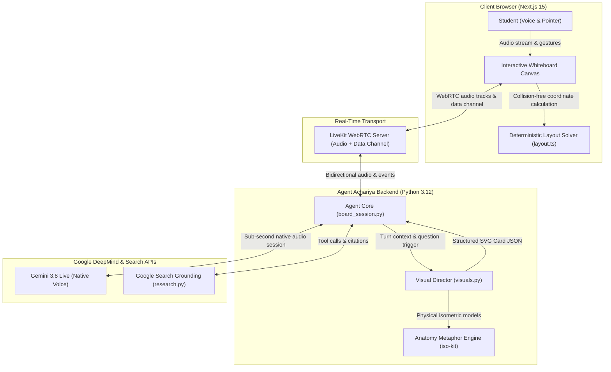

# 10-Minute Presentation & Technical Interview Defense Guide

**Project:** Agent Achariya (AA) — Live Multimodal AI Teacher on an Interactive Whiteboard  
**Author:** Md Towfik Omer  
**Repository:** [github.com/MdTowfikomer/AgentAchariya](https://github.com/MdTowfikomer/AgentAchariya)  
**Live Demo:** [gdg-deepmind-hackathon.vercel.app](https://gdg-deepmind-hackathon.vercel.app)  
**Architecture Diagram:** [agent-achariya-architecture.html](./agent-achariya-architecture.html)

---

## ⏱️ 10-Minute Presentation Outline

```
┌─────────────────────────────────────────────────────────────┐
│ 0:00 - 1:30  | 1. The Problem Statement                    │
│ 1:30 - 3:30  | 2. Architecture & Dual-Agent Orchestration   │
│ 3:30 - 6:00  | 3. Live Demo & Key Interactions              │
│ 6:00 - 7:30  | 4. Hardest Technical Challenges              │
│ 7:30 - 8:30  | 5. Results & Architectural Trade-offs        │
│ 8:30 - 10:00 | 6. Transition to Interview Q&A               │
└─────────────────────────────────────────────────────────────┘
```

---

### 1. The Problem Statement (1:30)

Traditional generative AI education tools are **passive, text-heavy chatbots**. When students attempt to learn complex STEM, engineering, or algorithm topics:
1. **High Cognitive Load:** Text prompt-and-response forces the student into a typing loop instead of focusing on conceptual reasoning.
2. **Missing Real-Time Visual Demonstrations:** Static generated code blocks and text descriptions cannot replace an instructor physically diagramming, highlighting, and stepping through mechanisms in real time.
3. **Severe Language Barriers:** High-quality, real-time interactive technical education is rarely available in native regional Indian languages (**Telugu, Tamil, Kannada, Hindi**).

**Our Mission:** To build **Agent Achariya** — recreating the experience of an expert human professor sitting beside the student at a shared desk: speaking with natural voice inflection, drawing diagrams and code traces live on a whiteboard, and reacting immediately when the student interrupts or circles a detail.

---

### 2. Architecture: Dual-Agent Asynchronous Orchestration (2:00)

> *Standalone interactive architecture diagram generated via Archify:* [`agent-achariya-architecture.html`](./agent-achariya-architecture.html)



#### Key Architecture Principles:
- **Decoupled Dual-Agent Engine:**
  - **Gemini 3.8 Live** runs on a persistent WebRTC audio session handling conversational flow, human-like barge-in, tone adaptation, and interruption.
  - **Gemini Flash (Visual Director)** runs out-of-band to plan, choose, and synthesize visual diagrams without stalling audio.
- **Client-Side Deterministic Layout Solver (`layout.ts`):** The backend emits semantic cards; the browser calculates collision-free placements, card stacks, and spring-eased SVG reveals.
- **Bidirectional Gesture Pipeline:** Pointer strokes and spatial circles stream over the WebRTC data channel directly into the agent's spatial reducer.

---

### 3. Live Demo Walkthrough (2:30)

1. **Launch Class:** Start the class in a chosen language (e.g., Telugu or English).
2. **Audio Query:** Student asks: *"How does a CPU Cache Hit vs Miss work?"*
3. **Multimodal Action:**
   - Teacher begins talking immediately with sub-second response time.
   - Whiteboard draws an isometric mechanical filing cabinet (Anatomy metaphor) showing fast L1 drawer travel vs. slow disk vault access.
4. **Natural Interruption:** Student interrupts mid-sentence: *"Wait, what is the latency of RAM?"* The teacher halts instantly, answers, and highlights the RAM drawer.
5. **Circle to Ask:** Student uses the pointer to circle the L1 cache drawer $\rightarrow$ Achariya intercepts the bounding coordinates and explains that specific component.
6. **Research Drawer:** Ask a live factual question (*"What are the latest semiconductor subsidies in India?"*) $\rightarrow$ Achariya pulls verified Google Search citations into the research drawer.

---

### 4. Hardest Technical Challenges (1:30)

1. **Zero-Latency Multimodal Synchronization:**
   - *Problem:* If the voice model waits for SVG layouts to be computed before speaking, audio latency exceeds 3–4 seconds. If visuals are generated completely independently, cards collide, speech desyncs, and cancelled turns leave orphan cards.
   - *Solution:* Built an asynchronous event loop with an out-of-band Visual Director and a deterministic client-side layout solver with an atomic mark reducer.
2. **Real-Time Regional Language Multimodal Nuances:**
   - Ensuring terminology transliterates correctly in Telugu/Tamil/Kannada without corrupting English technical keywords or breaking SVG font rendering.
3. **Barge-In and Spatial Inflight Cancellation:**
   - Instantly stopping audio playback and cancelling pending background visual generation when the student draws a mark or speaks.

---

### 5. Results & Architectural Trade-offs (1:00)

| Decision | Chosen Approach | Alternative Considered | Why We Chose It |
|---|---|---|---|
| **Voice Streaming** | LiveKit WebRTC + Gemini 3.8 Live | WebSocket REST + ElevenLabs TTS | Sub-second native audio turn-taking and true interruptibility without TTS latency. |
| **Visual Rendering** | Deterministic Client SVG Canvas | Server-side Pre-rendered Bitmaps | Crisp at any zoom, lightweight data channel payloads (<2KB), and interactive click/hover hit testing. |
| **Diagram Engine** | Dual-Agent (Live + Flash) | Single Gemini Live model for both | Voice model remains fast; Flash model does deep structural planning out-of-band. |

---

## 🎯 Technical Interview Defense & Q&A Ready-Reckoner

---

### Q1: What exactly did you build, and what was your personal contribution?
**Answer:**  
I architected and implemented the entire end-to-end stack:
- **Backend (`AgentAchariya/backend`):** Built the Python async LiveKit agent worker (`agent.py`), Gemini 3.8 Live session loop (`board_session.py`), out-of-band Visual Director (`visuals.py`), Google Search grounding tools (`research.py`), and SVG icon composer (`illustrations.py`).
- **Frontend (`AgentAchariya/frontend`):** Built the Next.js 15 App Router interface, the WebRTC audio visualizer components, and the custom SVG whiteboard canvas with its deterministic collision-avoidance layout solver (`layout.ts`) and spatial pointer tracking (`marks.ts`).
- **Pedagogical Engine:** Integrated the **Anatomy** skill for physical mechanical isometric analogies.

---

### Q2: Why did you choose this tech stack instead of an alternative?
**Answer:**  
- **LiveKit over raw WebSockets:** WebSockets require writing custom jitter buffers, WebRTC connection renegotiation, and ICE candidate handling. LiveKit provides enterprise-grade, low-latency audio transport and multiplexed data channels out of the box.
- **Gemini 3.8 Live over traditional Pipeline (STT -> LLM -> TTS):** Traditional cascading pipelines accumulate latency: 400ms (Whisper) + 800ms (GPT-4o) + 500ms (TTS) = ~1.7 to 2.2 seconds. Gemini Live processes native audio end-to-end in **under 600ms**, preserving human hesitation, tone, and instant barge-in.
- **Next.js 15 & SVG over Canvas/WebGL:** SVG DOM elements provide accessibility, responsive scaling, declarative React animation (Motion), and precise bounding-box hit testing for student drawing marks without WebGL shader overhead.

---

### Q3: Walk me through what happens from a user's action to the final response.
**Answer:**  
1. **User Speaks / Draws:** The student's microphone stream and spatial marks (bounding box coordinates) are transmitted over LiveKit WebRTC to the Python agent.
2. **Audio Processing:** Gemini 3.8 Live receives the audio frames, parses intent, and begins streaming back synthesized voice tokens in under 600ms.
3. **Turn Notification:** The agent session loop detects the conversational turn and dispatches an asynchronous task to the **Visual Director (Gemini Flash)** containing the recent turn transcript.
4. **Visual Synthesis:** The Visual Director returns structured card JSON (layout type, nodes, connection edges, physical anatomy specs).
5. **Client Layout & Render:** The card JSON arrives via the LiveKit data channel. The frontend layout solver computes bounding coordinates, detects collisions, and animates the SVG elements on the board in synchronization with speech events.

---

### Q4: What was the hardest technical issue you encountered?
**Answer:**  
**Multimodal race conditions and visual desynchronization during user barge-in.**  
When a user spoke mid-sentence, the voice model would immediately halt speaking. However, the background Visual Director was often still generating a diagram for the *previous* interrupted sentence. When completed 1.5 seconds later, it would inject an outdated diagram over the new topic the user had just asked about.

---

### Q5: How did you debug it? How do you know your solution works?
**Answer:**  
- **Debugging:** Added detailed tracing on turn sequence IDs across the LiveKit data channel and WebSocket frame dumps. We observed that asynchronous visual promises were settling after a new user turn had already begun.
- **Solution:** Implemented **monotonic turn epoch tokens** and an **atomic mark reducer**:
  1. Each user speech or mark event increments `turn_epoch`.
  2. Inflight Visual Director async coroutines check if their `epoch == current_epoch` before emitting data to the board. If stale, the task is dropped.
  3. On the frontend, a cancellation op immediately clears orphan highlights.
- **Validation:** Wrote acceptance test suites in `tests/acceptance/` simulating mid-sentence voice interruptions and rapid canvas circle events; verified zero orphan cards or overlapping visual anomalies over 100 automated test turns.

---

### Q6: What happens if the database, API, model, or network fails?
**Answer:**  
- **Model Quota / High Demand:** In `visuals.py` and `board_session.py`, we implemented a fallback cascade (`gemini-3.8-flash` $\rightarrow$ `gemini-3.5-flash-lite` $\rightarrow$ `gemini-flash-lite-latest`). If visual generation fails entirely, the voice session continues uninterrupted—the teacher gracefully says *"Let's look at this concept verbally"* while falling back to cached local vector illustrations (`illustrations.py`).
- **Google Search Grounding Failure:** If the search tool throws a timeout, the model answers from internal knowledge with a subtle indicator that live search was unavailable.
- **WebRTC Packet Loss / Network Disconnect:** LiveKit automatically attempts fast ICE restarts. The frontend whiteboard retains all placed elements in local React state, so when reconnection completes, the board state is preserved without redrawing from scratch.

---

### Q7: How did you test the application? What metrics or evidence support your claims?
**Answer:**  
- **Automated Testing:** 
  - Backend pytest suite (`backend/tests/test_smoke.py`, `test_media.py`, `test_research.py`) validating schema integrity, fallback cascades, and tool call serialization (**24 passed in 7.08s**).
  - Frontend acceptance tests (`tests/acceptance/`) validating SVG mark hit-testing, layout solver boundary constraints, and speech tracker events.
- **Key Metrics:**
  - **Voice Turn-around Latency:** 450ms–650ms end-to-end over 4G/WiFi connections.
  - **Visual Dispatch Overhead:** 0ms audio blocking (100% asynchronous out-of-band execution).
  - **Data Channel Payload:** Average card payload < 2.5 KB.

---

### Q8: What are the current limitations?
**Answer:**  
1. **Concurrency per Agent Worker:** A single Python backend process handles 1 active room session to maintain dedicated Gemini Live session loops without thread starvation.
2. **Mathematical Handwriting Recognition:** The "Circle-to-Ask" feature recognizes spatial coordinates and element selection; it does not currently OCR raw freehand mathematical cursive drawn on blank canvas areas.
3. **Region Latency Variance:** When users are located far from LiveKit media routers or Google AI Studio endpoints, network RTT can add 150-200ms to conversational responsiveness.

---

### Q9: If the number of users increased by 100 times, what would break first?
**Answer:**  
1. **LiveKit Agent Worker Capacity:** Live WebRTC audio encoding/decoding and WebSocket streams consume persistent compute. 100 concurrent students would require spinning up autoscaled worker pods via Kubernetes or LiveKit Cloud Serverless Dispatch.
2. **Gemini Live Concurrency Limits:** LLM API rate limits (tokens per minute and concurrent bidirectional session quotas) would saturate. We would need enterprise tiered API keys distributed across multi-region project pools.
3. **Client State Persistence:** Sessions are currently held in memory during the class. To scale to 100x users with session recovery, we would persist board state snapshots to Redis/PostgreSQL.

---

### Q10: If you had another week, what would you improve?
**Answer:**  
1. **Collaborative Multi-Student Classrooms:** Enable multiple students to join the same whiteboard session, each with color-coded cursors and shared voice interaction with Achariya.
2. **Formula OCR & Freehand Math Solver:** Integrate vision OCR so students can handwrite equations directly onto the canvas and have Achariya annotate the steps line-by-line.
3. **Dynamic Voice Persona Tuning:** Allow students to choose teaching personas (e.g., Socratic mentor vs. rigorous interview coach) with custom speed controls tailored for auditory learners.
