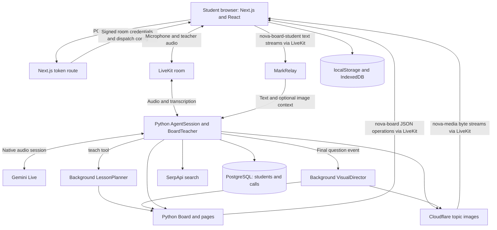

# Agent Achariya: architecture and codebase guide

Prepared from the current checkout on 2026-10-27. This is a source walkthrough, not a live integration test or a claim that every feature currently works. The existing graphify graph was used for navigation; current source was checked for the runtime paths described below. Model names below are literal configuration strings in this repository, not independently verified provider availability.

## 1. What the application actually is

A browser-based voice tutor with a shared, interactive SVG whiteboard. A student speaks, the teacher replies with audio, and structured operations update the board. Students can mark a specific part of the board and send that visual context back into the conversation.

There are two application runtimes:

- **Next.js/React frontend and server routes:** renders the interface, obtains LiveKit join credentials, manages browser archives, and serves database-backed dashboard APIs.
- **Python LiveKit agent worker:** joins dispatched rooms, runs the live teacher, exposes teaching tools, schedules visual work, and writes student memory and call counters.

**LiveKit connects them.** The teaching backend is a room-connected worker, not a FastAPI server. The main voice interaction does not pass through a Next.js REST endpoint for every turn.

The diagram groups transport hops for readability: room data and byte streams travel through LiveKit, rather than direct Python-to-browser sockets.

## 2. Trace a class from start to finish

### Joining

1. `frontend/app/layout.tsx` loads global styles, fonts, theme support, and app metadata.
2. `frontend/app/page.tsx` loads app configuration and renders `App`.
3. `frontend/components/app/app.tsx` creates `useSession` with a token source, wraps the interface in `AgentSessionProvider`, and renders `NovaView`.
4. `NovaView` requests microphone permission before joining. It sets the resume cookie and calls the session's start method.
5. `POST /api/token` creates a signed LiveKit JWT. It includes room permissions, language/resume attributes, a three-hour TTL, and explicit dispatch configuration when supplied or configured by `AGENT_NAME`.
6. The Python worker registers the name `nova-te` in `backend/src/agent.py`. Dispatch configuration must match it.
7. `run_board_session` creates shared classroom state, the teacher, the session, event handlers, and the student-message relay. It starts the session, connects, reads participant attributes, and greets the student or resumes their conversation.

### Speaking and drawing

1. The browser publishes microphone audio to LiveKit.
2. LiveKit's agent integration passes audio to the configured Gemini Live model and returns generated audio. Transcription is enabled for both input and output.
3. The teacher can call `teach(topic, focus)`. This publishes a planning event and schedules a lesson-planning task, allowing it to introduce the topic while planning runs.
4. `LessonPlanner.plan` requests schema-constrained JSON, tries configured fallback models with per-attempt timeouts, and normalizes the lesson.
5. `show_step` waits for planning if necessary, reveals a step, and returns descriptions and target addresses to the teacher. This step can wait; the entire drawing path is not latency-free.
6. `Board.publish` sends small JSON operations on `nova-board`, scoped to a page.
7. The browser applies operations with reducers, computes layout, and renders element components as SVG and supporting interactive content.
8. Separately, final user transcripts trigger the Visual Director when the agent begins thinking/speaking. Filler utterances and repeated questions are skipped. It may suggest a diagram, supporting illustration, or topic-image request. It checks whether the question/page changed before applying results and avoids some duplicate visuals.

### Circle-to-ask

1. Pointer coordinates are transformed from screen coordinates into SVG board coordinates.
2. Nearby strokes are grouped; `shapeOf` classifies the mark as circle, underline, or scribble.
3. `hitTest` compares the mark to layout bounds. It prefers fine-grained parts such as an array cell, code line, or diagram node over the entire element.
4. The browser resolves target descriptions and captures a JPEG crop of the marked region, including nearby context.
5. A `StudentMark` includes the page, shape, target IDs, descriptions, optional image, and whether the student is explicitly asking for help.
6. It is sent as JSON through a `nova-board-student` text stream.
7. `MarkRelay` follows the referenced page and injects text plus optional `llm.ImageContent` into the conversation.
8. An explicit ask interrupts the teacher and generates a new reply. A context-only mark is held for a suitable point, so a follow-up such as “what is this?” has a referent.

The useful engineering distinction: the system sends both **semantic addresses** and **visual evidence**. An image alone may be ambiguous; an element ID alone cannot represent arbitrary handwriting.

### Checkpoints

`ask_checkpoint` prepares a question with optional stable option IDs, hints, criteria, and answer key. It associates the checkpoint with a concept and originating page. When a speech handle supports playback completion, the backend waits for it and emits `checkpoint_ready` unless interrupted.

The browser has its own lifecycle reducer and playback matching logic. It supports typed, option-chip, and final voice-transcript submissions. Submissions go back through `MarkRelay`; the backend evaluates supported answer formats, publishes feedback, and requests a verbal response.

This is not a general-purpose semantic grader: backend grading uses option matching and keyword/negation heuristics, and unsupported/open-ended responses can remain pending for teacher review. The browser also contains grading logic; consistency between these implementations matters.

### Ending and resuming

- On shutdown, image tasks are closed/cancelled and call counters are finalized.
- Chat records are kept in browser `localStorage` with a bounded chat history.
- Board/page state and generated media are archived in IndexedDB.
- Reopening a chat loads its board archive; continuing sends restored board state and a transcript to the worker. The worker waits briefly for this resume payload and uses it in its greeting.
- Persistent student facts are separate from the browser archive and use PostgreSQL.

## 3. Backend file map

All paths in this section are relative to `backend/`.

| File | Responsibility and important details |
|---|---|
| `src/agent.py` | Worker entry point. Loads `.env.local`, invokes environment validation, creates `AgentServer`, sets up one planner per process, and registers the `nova-te` room handler. Delegates the class to `run_board_session`. |
| `src/board_session.py` | Main orchestration module. Defines personas, `Classroom`, `BoardTeacher` and tool methods, `MarkRelay`, live-model construction, event handlers, startup/resume, background visual coordination, and shutdown. This is the main file to understand first. |
| `src/board.py` | Lesson JSON schemas and planner; repairs/normalizes model output; describes target elements; owns Python `Page` and `Board` state, page switching/restoration, element IDs, step reveal, array updates, and checkpoint data/evaluation. Publishes board events. |
| `src/board_prompts.py` | Composes teacher identity, language behavior, teaching rules, board/tool use, checkpoint behavior, interruption handling, memory guidance, specialist instructions, and fresh/resume greetings. These are instructions to the model, not hard guarantees. |
| `src/visuals.py` | Background visual planner. Requests structured diagram/supporting-visual plans and validates them. Maps richer diagram intentions into supported geometries such as flow, cycle, hub, timeline, layers, and comparison. Pixel layout is primarily computed in the frontend. |
| `src/illustrations.py` | Resolves supporting SVG illustrations with caching. Tries a specialized IoT composition, local SVGs, Iconify, composed SVGs, and generated SVG fallback. Some compositions expose individually targetable parts. |
| `src/media.py` | Optional Cloudflare image pipeline. Chooses overview vs follow-up image models, builds wordless image prompts, validates returned formats, caches results, limits work, rejects stale page/topic generations, streams bytes, and emits status/element events. Does not currently implement generated video. |
| `src/research.py` | Queries SerpApi Google search in a background thread with timeouts, filters unusable/duplicate results, and returns source-backed excerpts. Handles provider errors without including key-bearing request URLs. Does not fetch and read full articles. |
| `src/memory.py` | PostgreSQL connection pool and student fact persistence. Normalizes names into keys; stores facts in JSONB. Runs database coroutines on a dedicated daemon-thread event loop and bridges results back to the agent loop. Database absence/failure can disable persistence without stopping the class. |
| `src/analytics.py` | Creates/writes the `calls` table and judges call outcomes from counters rather than asking an LLM to rate itself. Shares the database execution infrastructure from memory. A successful counter is a delivery signal, not proof of learning. |
| `src/config.py` | Logs missing required/recommended environment settings. Its current validation does not itself raise/exit for a missing required key; later model construction can still fail. |
| `src/locale_map.py` | Small immutable language/register profile. Default profile is Telugu/Telangana; the selected session language can come from participant attributes. |
| `src/registers/te_telangana.md` | Telugu dialect/register guidance loaded into teacher prompts. |
| `src/__init__.py` | Package marker. |
| `src/assets/svg/*` | Reusable illustration source assets, resolved by `illustrations.py`. |
| `scripts/preview_topic_images.py` | Standalone image-model preview utility; separate from starting a live teacher. |
| `tests/test_smoke.py` | Local behavioral tests including pointer parsing, diagram normalization, semantic illustrations, checkpoint creation/playback, submissions, and answer evaluation. |
| `tests/test_media.py` | Image request deduplication, page/topic routing, stale work, failure isolation, and generation-related behavior. |
| `tests/test_research.py` | Source normalization, error/key handling, missing provider configuration, and learning-action delivery. |
| `pyproject.toml` | Python package/dependency definitions plus pytest and Ruff settings. |
| `uv.lock` | Resolved dependency lockfile. |
| `.python-version` | Local Python version selection. |
| `.env.example` | Example settings; actual worker loads `.env.local`. |
| `Dockerfile` | Multi-stage uv-based Python image, locked dependency install, model-file download, non-root runtime, and worker startup. |
| `railway.toml` | Docker build/deployment and worker start/restart configuration. |
| `.dockerignore`, `.gitignore` | Exclude local/build/private files from Docker context or Git. |
| `.github/workflows/ruff.yml` | Ruff workflow definition. It is nested under `backend/`; do not assume the parent repository runs it automatically. |
| `README.md`, `LICENSE` | Backend documentation and license; some starter documentation may describe earlier versions. |

### The main backend classes

- **Classroom:** shared state across teacher persona changes: board, planner, director, researcher, image manager, student identity, language, stats, and resume state.
- **BoardTeacher:** model-facing teacher/tool surface. Tools include teaching, step reveal, annotations, diagram drawing, research, student memory, and persona handoffs.
- **MarkRelay:** browser-event adapter. Handles marks, page changes, language changes, resume payloads, learning actions, rejected media, and checkpoint responses.
- **LessonPlanner:** converts a topic into a normalized sequence of board steps.
- **Board/Page:** owns backend board content and emits page-scoped state changes.
- **VisualDirector:** generates supplementary visual plans from the current question and board inventory.
- **TopicImages:** coordinates asynchronous image work for the right page/topic generation.

The four personas are Acharya/Nova, Algo, Keerthi, and Vikram. A handoff changes the current agent/voice while retaining classroom state. This is different from four teachers concurrently debating a question.

## 4. Frontend file map

All paths in this section are relative to `frontend/`.

### Pages and server routes

| File | Responsibility |
|---|---|
| `app/layout.tsx` | Shared HTML shell, app metadata, fonts, global CSS, and theme provider/toggle. |
| `app/page.tsx` | Main entry page; reads app config and renders `App`. |
| `app/opengraph-image.tsx` | Social-sharing preview image. |
| `app/dashboard/page.tsx` | Student progress view, reading the named-student progress API. |
| `app/stats/page.tsx` | Aggregate call statistics and recent session outcomes. |
| `app/desk/page.tsx` | Human escalation queue and status controls. Its matching escalation producer is not present in the active backend source in this checkout. |
| `app/monitor/page.tsx` | Observer UI for `nova-outbound-*` rooms. Supporting outbound-call creation is not present in this checkout. |
| `app/api/token/route.ts` | Creates LiveKit join tokens, room dispatch settings, and participant language/resume attributes. |
| `app/api/student/[name]/progress/route.ts` | Reads student facts and recent calls from PostgreSQL; returns a default response if no database is configured. |
| `app/api/stats/route.ts` | SQL aggregates over `calls`, including outcomes, durations, channel counts, and recent activity. |
| `app/api/desk/route.ts` | Reads and updates `escalations` records. Tolerates a missing table on reads. |
| `app/api/monitor/route.ts` | Finds an outbound room and issues a subscribe-only observer token. |

### Application and classroom interface

| File | Responsibility |
|---|---|
| `components/app/app.tsx` | Creates the LiveKit session and token source, mounts providers, error/debug helpers, `NovaView`, audio-unlock button, and toast UI. |
| `components/app/theme-provider.tsx` | Wraps `next-themes`. |
| `components/app/theme-toggle.tsx` | Theme control mounted by the root layout. |
| `components/app/welcome-view.tsx` | Starter welcome component; the current `App` renders `NovaView` instead. |
| `components/nova/nova-view.tsx` | Top-level product UI: ready/connecting/live/ended/microphone-error screens, language selection, transcripts, persona announcements, learning actions, chat history, resume, and session controls. |
| `components/nova/i18n.tsx` | Language types, translation strings, context/hook, and language-cookie helpers. |
| `components/nova/canvas.tsx` | Earlier card-oriented canvas renderer for code, flows, problem cards, and related `nova-canvas` messages; also provides shared styling/types used elsewhere. The active detailed whiteboard is under `nova/board/`. |

### Whiteboard engine

| File | Responsibility |
|---|---|
| `components/nova/board/types.ts` | Browser contracts for elements, lesson steps, board operations, image status, student marks, checkpoint submissions, and geometry. Backend JSON must agree with these shapes. |
| `components/nova/board/board.tsx` | Runtime bridge between LiveKit and the rendered board. Receives operations/media, manages page/checkpoint state and archives, handles student ink/hit tests/crops, sends student events, tracks speech notes, and renders the board/tools/roadmap/research UI. |
| `components/nova/board/board-state.ts` | Pure page/book reducers, tutor-state derivation, checkpoint lifecycle and grading helpers, playback matching, and learner-response selection. Useful for studying behavior without React effects. |
| `components/nova/board/layout.ts` | Deterministic sizing and positioning for text/code/arrays/trees/tables/diagrams/cards and checkpoint content. Produces element/subpart rectangles and address lookup. It computes render geometry rather than asking an LLM for pixels. |
| `components/nova/board/elements.tsx` | Actual renderers for board element types, animated writing, speech/explanation cards, diagrams, media controls, illustrations, and checkpoint interaction controls. |
| `components/nova/board/marks.ts` | Stroke bounds, shape classification, fine-grained target hit tests, and SVG-region-to-JPEG capture. |
| `components/nova/board/sketch.ts` | Drawing/handwriting-style path helpers and smoothing. |
| `components/nova/board/speech-tracker.ts` | Assigns transcript segments to a board and concept. Uses stable line IDs, activation watermarks, chronological ordering, and separate archived base notes to avoid duplicated or misplaced explanations. |
| `components/nova/board/archive.ts` | Best-effort IndexedDB storage/retrieval for saved boards and media blobs. |
| `components/nova/board/image-layout.ts` | Inserts independently arriving topic images into visible lesson steps near the associated content. |
| `components/nova/board/research-panel.tsx` | Research event reducer and source/excerpt panel. |
| `components/nova/board/error-boundary.tsx` | Contains rendering failures in the board subtree and provides recovery UI. |
| `components/nova/board/layout.test.ts` | Geometry and layout regressions. |
| `components/nova/board/marks.test.ts` | Stroke classification and hit-testing behavior. |
| `components/nova/board/image-layout.test.ts` | Positioning of independently arriving images. |
| `components/nova/board/speech-tracking.test.ts` | Broad regressions for transcript/concept association and related board/checkpoint state/playback helpers. |

### LiveKit support components

These are reusable/starter transport and presentation components. Their presence does not mean all are mounted in the main `NovaView` path.

| File under `components/agents-ui/` | Responsibility |
|---|---|
| `agent-session-provider.tsx` | Wraps LiveKit session context and includes remote-room audio playback. |
| `start-audio-button.tsx` | Unlocks browser audio playback where autoplay restrictions require user interaction. |
| `agent-control-bar.tsx` | Generic session input/control bar. |
| `agent-disconnect-button.tsx` | Disconnect action. |
| `agent-track-control.tsx` | Track/device control composition. |
| `agent-track-toggle.tsx` | Track enable/disable control. |
| `agent-chat-indicator.tsx` | Chat/agent activity indicator. |
| `agent-chat-transcript.tsx` | Generic conversation transcript presentation. |
| `agent-audio-visualizer-aura.tsx` | Aura-style audio visualization. |
| `agent-audio-visualizer-bar.tsx` | Bar audio visualization. |
| `agent-audio-visualizer-grid.tsx` | Grid audio visualization. |
| `agent-audio-visualizer-radial.tsx` | Radial audio visualization. |
| `agent-audio-visualizer-wave.tsx` | Wave audio visualization. |
| `react-shader-toy.tsx` | Shader rendering support for visual effects. |
| `blocks/agent-session-view-01/index.ts` | Exports the reusable starter session-view block. |
| `blocks/agent-session-view-01/components/agent-session-block.tsx` | Generic starter session screen composition. |
| `blocks/agent-session-view-01/components/audio-visualizer.tsx` | Selects/composes an audio visualizer for that block. |
| `blocks/agent-session-view-01/components/tile-view.tsx` | Track tile layout for the starter block. |

### Hooks, primitives, and configuration

| File/group | Responsibility |
|---|---|
| `hooks/useAgentErrors.tsx` | Surfaces agent/session problems to the interface. |
| `hooks/useDebug.ts` | Development/debug integration. |
| `hooks/agents-ui/use-agent-control-bar.ts` | State/behavior supporting generic track controls. |
| `hooks/agents-ui/use-agent-audio-visualizer-{aura,bar,grid,radial,wave}.ts` | Matching audio-derived state for each of the five visualizers. |
| `components/ai-elements/conversation.tsx` | Generic conversation container and scroll behavior. |
| `components/ai-elements/message.tsx` | Generic message/response presentation. |
| `components/ai-elements/shimmer.tsx` | Shimmer/loading text. |
| `components/ui/alert.tsx` | Alert primitive. |
| `components/ui/button.tsx` | Button primitive/variants. |
| `components/ui/button-group.tsx` | Grouped button presentation. |
| `components/ui/select.tsx` | Selection control primitives. |
| `components/ui/separator.tsx` | Visual separator. |
| `components/ui/sonner.tsx` | Toast integration. |
| `components/ui/toggle.tsx` | Toggle primitive. |
| `components/ui/tooltip.tsx` | Tooltip primitive. |
| `lib/utils.ts` | App configuration loading/caching, style derivation, and alternative sandbox token-source helpers. |
| `lib/shadcn/utils.ts` | CSS class composition helper. |
| `app-config.ts` | Product branding, capabilities, visualizer defaults, and agent dispatch configuration. |
| `styles/globals.css` | Global styling, tokens, font behavior, and board/UI styles. |
| `public/*`, `fonts/*` | Static branding and font assets. |
| `package.json`, `pnpm-lock.yaml` | Dependencies, resolved versions, and dev/build/test/format commands. The current dev script uses **port 3002**. |
| `next.config.ts` | Turbopack root, dev indicator settings, and build lint behavior. ESLint errors are ignored during build; a successful build alone does not establish a clean lint run. |
| `tsconfig.json` | TypeScript compiler settings and import aliases. |
| `postcss.config.mjs` | CSS/Tailwind processing. |
| `eslint.config.mjs`, `.eslintrc.json` | Lint configuration files; validate current tool behavior rather than assuming both apply. |
| `.prettierrc`, `.prettierignore` | Formatting rules/exclusions. |
| `components.json` | shadcn component generation configuration. |
| `.npmrc` | Package-manager settings. |
| `.env.example` | Example server/client environment settings. |
| `taskfile.yaml` | Task runner configuration. |
| `.github/workflows/build-and-test.yaml` | Lint/format/build workflow definition. Nested under `frontend/`, so parent-repository GitHub Actions does not automatically discover it there. It does not itself run the Vitest suite. |
| `.gitignore`, `README.md`, `LICENSE` | Ignore rules, frontend documentation, and license. |

## 5. Transport contracts and storage

| Channel | Payload | Why it exists |
|---|---|---|
| LiveKit audio tracks | Student mic and teacher speech | Continuous, interruptible voice interaction. |
| Track transcription | Student/teacher speech segments | Live transcript, concept notes, and checkpoint playback/answer tracking. |
| `nova-board` data topic | Small JSON board/research/checkpoint/status operations | Update structured UI state without sending media inside small data packets. |
| `nova-board-student` text stream | JSON marks, JPEG data URLs, language/page/resume/learning actions, checkpoint responses | Carry larger and structured student context back to the teacher. |
| `nova-media` byte stream | Image bytes with ID/page/source attributes | Deliver generated images independently of board operations. |
| `nova-canvas` data topic | Persona announcements and older card payloads | Teacher identity/skin changes and compatibility with the earlier canvas. |

| State | Location | Lifetime/limits |
|---|---|---|
| Classroom, current teacher, pending plans | Python job memory | Live session. |
| Board/page content | Python `Board` and browser reducer state | Live session; browser copy can be archived/restored. This is not a general multi-user CRDT. |
| Chat history | Browser localStorage | Local to that browser/profile; capped chat list. |
| Saved board/media | Browser IndexedDB | Local to that browser/profile, best-effort storage. |
| Student facts | PostgreSQL `students` | Persistent when configured; currently keyed by normalized name. |
| Session counters/outcome | PostgreSQL `calls` | Persistent when configured; content-free counters, not full transcript storage. |
| Escalation queue | Expected PostgreSQL `escalations` table | UI/API remain, but no active backend producer was found in this checkout. |

## 6. Decisions worth understanding for the interview

1. **Keep slow visual generation out of the main voice turn.** Planner/director/image tasks can take seconds. Background work lets the teacher remain conversational, but creates stale-result and coordination problems.
2. **Let models propose content; let code own geometry.** Schema-constrained lesson/diagram output is normalized before deterministic layout/rendering. Model output still needs validation and can be incorrect.
3. **Address board parts explicitly.** IDs such as `element#part` let both highlights and student questions refer to the same object. JPEG context supplements this for handwriting and image regions.
4. **Capture ownership before awaiting work.** Image jobs retain the originating page and topic generation; late results must not appear in a new lesson. The director also checks page/question freshness.
5. **Separate database lifecycle from the agent executor.** `memory.py` documents an executor-shutdown issue encountered with LiveKit. Its private loop/thread keeps PostgreSQL DNS/connection work isolated. This introduces thread lifecycle and cross-loop complexity.
6. **Treat checkpoint playback as state.** Prepared, awaiting-response, answered, and completed are different moments. Speech completion, final transcriptions, stable IDs, and originating board/concept are needed to avoid accepting unrelated utterances.
7. **Separate archived notes from live speech updates.** `speech-tracker.ts` retains stable segments and concept watermarks rather than repeatedly appending the full transcript to whichever card is active.

Do not claim personal ownership of any decision unless you actually implemented or substantially worked on it. Source comments explain implementation intent; they do not establish authorship.

## 7. README differences and practical limits

- **Images:** current `media.py` uses Cloudflare FLUX Klein/Schnell, not the README's Nano Banana image pipeline. It explicitly describes no video generation.
- **Research:** current `research.py` uses SerpApi search snippets, not Gemini-native Google Search grounding or full-page research.
- **Planning/directing defaults:** current code defaults to `gemini-3.1-flash-lite`, with fallback strings. The live voice default is `gemini-3.8-live`; environment variables can override these.
- **Startup:** worker loads `.env.local` and expects `GOOGLE_API_KEY`; frontend dev port is 3002. Older README setup instructions use different names/ports.
- **Specialists:** persona tools hand off the active teacher while sharing classroom state; they are not concurrent independent conversational agents.
- **Progress:** call delivery counters and stored learning facts exist. They do not establish measured educational mastery or learning improvement.
- **Identity:** normalized student names are identifiers for the prototype, not authenticated user identities. Python and JavaScript name normalization also differ for non-Latin characters.
- **Access controls:** inspected token/dashboard/admin routes do not include an application authentication layer. Do not describe them as production-ready multi-user authorization.
- **Old features:** phone monitor and human desk routes remain, but phone/escalation producer modules are absent from the active backend directory.
- **Compatibility workaround:** `_patch_realtime_audio` monkey-patches the Google SDK method to adapt legacy media chunks into audio/video fields. Understand the problem and dependency-version coupling before presenting it as a challenge you solved.

These are boundaries of what the checked source supports, not requests to expand the project before the interview.

## 8. Remaining repository directories and support files

| Path | Role |
|---|---|
| `start_app.ps1`, `start_app.sh` | Convenience launchers for worker/frontend and optional local LiveKit server. Configuration must point both applications at the same LiveKit service. |
| `tests/acceptance/fixture.tsx` | Browser fixture mounting production board components with controllable sample state. |
| `tests/acceptance/livekit-fixture.ts` | Fake LiveKit transport for emitting board/media events and recording outgoing student messages. |
| `tests/acceptance/run.cjs` | Chrome/Playwright acceptance runner covering real board rendering and interactions with stubbed transport. Has machine-specific Chrome/temp-tool paths and expects an already running app; not a portable one-command live end-to-end test. |
| `docs/acharya-learning-recommendations.md` | Learning-experience recommendations; proposals should not be treated as already implemented. |
| `docs/gemini-api-quota-findings.md` | Provider quota investigation; historical findings, not a current quota guarantee. |
| `tasks/plan.md`, `tasks/todo.md` | Planning/task notes; implementation evidence takes precedence over checklists. |
| `graphify-out/` | Generated architecture graph/report and graph query memory. Can be stale; useful for navigation. |
| `.archify/` | Diagram-related support/output directory. |
| `artifacts/` | Captured verification/demo outputs; not application runtime code. |
| `.agents/skills/` | Development-agent workflow instructions; they are not the teacher's runtime prompts. |
| `.ui-craft/`, `.backboard/`, `.cortex/`, `.scratch/` | Local design/workflow/scratch metadata directories; not imported by the main paths traced above. Contents were not exhaustively audited for this guide. |
| `.gitignore`, `LICENSE`, `README.md` | Repository exclusions, licensing, and high-level project introduction. |

## 9. Suggested reading order

1. `frontend/components/app/app.tsx` and `frontend/app/api/token/route.ts`: joining and transport setup.
2. `backend/src/agent.py` and `run_board_session` in `board_session.py`: worker and session lifecycle.
3. `Classroom`, `BoardTeacher.teach`, `show_step`, and `MarkRelay`: classroom behavior.
4. `backend/src/board.py`: schemas, planner, board state, operations.
5. `frontend/components/nova/board/types.ts`, `board-state.ts`, and `board.tsx`: receiving those operations.
6. `layout.ts`, `elements.tsx`, and `marks.ts`: drawing and referring to content.
7. `visuals.py`, `media.py`, and `illustrations.py`: independent visual paths.
8. `speech-tracker.ts` and checkpoint logic: speech/board coordination.
9. `memory.py`, `analytics.py`, `research.py`, and corresponding APIs: persistence and external services.
10. Tests for each subsystem: concrete edge cases the current implementation is designed to handle.

## 10. A concise architecture explanation to rehearse

> Agent Achariya has a Next.js interface and a Python LiveKit worker. LiveKit carries real-time speech and structured board events. The live teacher handles conversation and calls teaching tools, while separate background tasks plan lesson content and supplementary visuals. The browser computes the SVG layout from structured operations. When a student marks something, I send the specific board targets plus a cropped image back into the conversation, so the teacher can explain that exact part. Browser archives preserve classes locally, while PostgreSQL stores student learning facts and call counters.

Follow this with one technical problem you personally tackled and evidence of how you verified the solution. Do not turn the ten-minute presentation into a tour of every support component.
